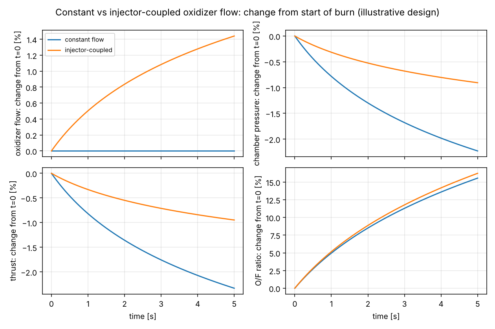

# Injector-Coupled Oxidizer Flow (optional)

By default the simulator holds the oxidizer flow rate constant. With the injector option on, the
oxidizer flow is **solved at every time step** from the pressure drop across the injector, so the
chamber pressure and the oxidizer flow now affect each other.

## Equations
For a liquid oxidizer through the injector, with the chamber pressure from choked nozzle flow:

    mdot_ox = Cd_inj * A_inj * sqrt( 2 * rho_ox * (P_tank - Pc) )
    Pc      = ( mdot_ox + mdot_fuel(mdot_ox) ) * c* / ( Cd_nozzle * A_throat )
    mdot_fuel = rho_fuel * (2 pi r L) * a * ( mdot_ox / (pi r^2) )^n

The two unknowns (mdot_ox and Pc) are solved together at each step with a bracketed root finder.
Port regression is then advanced as before.

## How to use
```python
from core.engine import HybridRocketSimulator

sim = HybridRocketSimulator(
    tank_pressure=7.6e6,                  # Pa, held constant (no blowdown)
    injector_area=39.8e-6,                # m^2, total injector orifice area
    injector_discharge_coefficient=0.70,
    oxidizer_density=800.0,               # kg/m^3, liquid oxidizer
)
df = sim.simulate()                       # extra column: oxidizer_flow_kg_s
```
The option is off unless `tank_pressure` and `injector_area` are both above zero. When it is on,
`oxidizer_flow_rate` is ignored. With it off, results are identical to before.

## Verification (tests/test_injector_coupling.py, all pass)
- With the option off, output is identical to the constant-flow model.
- The injector equation holds at every step (relative error below 1e-9).
- The solution at t = 0 matches an independent damped fixed-point iteration.
- With a very high tank pressure the flow recovers the constant-flow limit (within 0.5 %).
- Oxidizer flow rises and chamber pressure falls as the port opens; Pc stays below tank pressure.
- Fuel mass balance still closes, and the result converges as the time step is reduced.

## What it changes (illustrative design, default grain, injector sized for 1.5 kg/s at t = 0)
Constant flow: chamber pressure falls 2.2 % and thrust 2.3 % over the 5 s burn.

| Tank pressure (bar) | Injector drop / Pc | Oxidizer flow change | Chamber pressure change | Thrust change |
|---|---|---|---|---|
| 62 | 7 % | +2.1 % | −0.3 % | −0.3 % |
| 65 | 12 % | +1.9 % | −0.5 % | −0.5 % |
| 70 | 21 % | +1.7 % | −0.7 % | −0.7 % |
| 76 | 31 % | +1.4 % | −0.9 % | −0.9 % |
| 100 | 73 % | +0.9 % | −1.4 % | −1.4 % |
| 200 | 245 % | +0.4 % | −1.9 % | −2.0 % |



For this slowly evolving 5 s burn the effect is small (1 to 2 %): as the port opens, chamber pressure
falls, the injector passes slightly more oxidizer, and this reduces the thrust droop. The effect would be larger
for long burns or large port growth, and the coupling now lets the model be used to size an injector.

## Limitations
- Tank pressure is constant (a regulated or very large tank); tank blowdown is not modelled.
- Incompressible single-phase injector flow. Two-phase effects such as N2O flashing are not included.
- Quasi-steady chamber pressure: no chamber filling, ignition transient or feed-line dynamics, and
  no combustion-instability or injector-stiffness criteria.
- The illustrative values (7.6 MPa, Cd 0.70, 800 kg/m^3) are not a specific hardware design.
- Not yet compared with measured injector or tank data.
