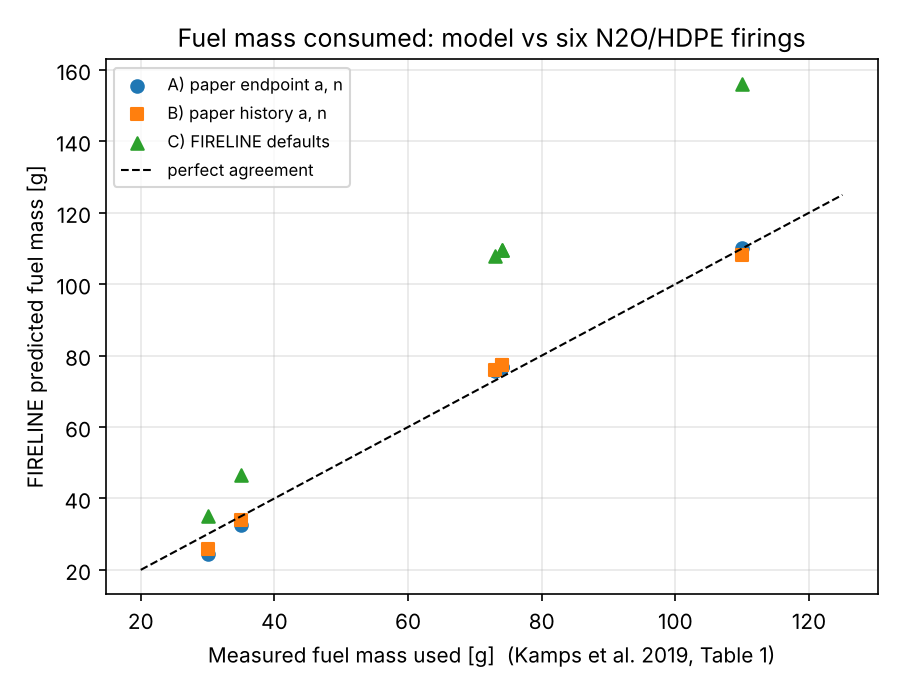

# Comparison with Published N2O/HDPE Firing Data

This compares the simulator's **fuel mass consumed** with six static firings reported in:

> L. Kamps, K. Sakurai, Y. Saito and H. Nagata, "Comprehensive Data Reduction for N2O/HDPE
> Hybrid Rocket Motor Performance Evaluation", *Aerospace* 6(4), 45, 2019.
> doi:10.3390/aerospace6040045 (open access, CC BY 4.0).

Run it with `python validation/validate_kamps2019.py` from the repository root.

## What is compared, and what is not
- **Compared:** total fuel mass consumed per test (Table 1 of the paper).
- **Not compared:** chamber pressure and thrust. FIRELINE takes the characteristic velocity c*
  and discharge coefficient as inputs, so a pressure comparison would only test the c* that is
  put in. Nozzle erosion, which the paper reports, is not modelled either.

## Inputs taken from the paper
| Item | Value | Source |
|---|---|---|
| Fuel | polyethylene, 955 kg/m³ | text |
| Oxidizer flow | 41, 41, 39, 38, 39, 37 g/s (time-averaged per test) | Table 1 |
| Burn times | 3, 4, 10, 10, 10, 15 s (test labels) | Table 1 |
| Grain | 164 mm long, 46.7 mm outer diameter; first four blocks 20 mm port, last four 30 mm | Fig. 5c |
| Regression law | r_dot = a · G_ox^n (G_ox from oxidizer flow only), a = 4.36e-5, n = 0.62 (endpoint) or a = 2.52e-5, n = 0.76 (history) | Section 3.2.1 |

The stepped port is run as two single-port sections (20 mm × 72 mm and 30 mm × 92 mm, the latter
including a 10 mm head pocket) that each receive the full oxidizer flow, as a flux-only law
implies. The computed initial fuel mass is 185 g.

## Results
Error = (model − measured) / measured.

| Test | Burn (s) | Measured (g) | A: endpoint constants | B: history constants | C: FIRELINE defaults |
|---|---|---|---|---|---|
| 3s | 3 | 30 | 24.5 g (−18.2 %) | 25.8 g (−14.1 %) | 35.2 g (+17.4 %) |
| 4s | 4 | 35 | 32.5 g (−7.0 %) | 33.9 g (−3.0 %) | 46.6 g (+33.2 %) |
| 10s-I | 10 | 74 | 76.9 g (+4.0 %) | 77.4 g (+4.6 %) | 109.5 g (+48.0 %) |
| 10s-II | 10 | 73 | 75.8 g (+3.8 %) | 76.0 g (+4.1 %) | 107.9 g (+47.8 %) |
| 10s-III | 10 | 74 | 76.9 g (+4.0 %) | 77.4 g (+4.6 %) | 109.5 g (+48.0 %) |
| 15s | 15 | 110 | 110.0 g (0.0 %) | 108.1 g (−1.7 %) | 156.2 g (+42.0 %) |
| **Mean abs. error** | | | **6.2 %** | **5.4 %** | **39.4 %** |

**Hold-out check.** Fitting one constant (a, with n = 0.62) to the 3 s, 4 s and 15 s tests gives
a = 4.82e-5, which fits those three tests to within about 10 %. It then over-predicts the three 10 s tests
by 14.3 to 14.5 %.

## What this shows
- With the paper's published correlation, the model reproduces total fuel mass to within about 5 %
  on the 10 s and 15 s tests, and to within 14 to 18 % on the 3 s test. The largest errors are on
  the shortest burns. A likely cause is the start-up and shut-down consumption that the model does
  not include (constant oxidizer flow, instant start and stop), but this has not been tested here.
- The paper's constants were fitted by its authors to these same six tests, so runs A and B check
  that the implementation and the grain-geometry treatment are consistent with the data. They are
  not independent predictions. Only the hold-out check is predictive, and its error is 14.5 %.
- The default constants (a = 6.30e-5, n = 0.62) over-predict fuel mass by 17 to 48 % for this
  propellant pair. Regression constants depend on the propellant and must be set for the case.
- The geometry reading matters: removing the 10 mm head pocket from the 30 mm section moves the
  errors by about 5 to 6 percentage points.

## Limitations
- Oxidizer flow is held at each test's time-averaged value; in the real tests it dipped during the
  start-up pressure transient.
- Burn times are the nominal test labels, not the measured burn durations.
- The paper notes that blocks next to a step in port diameter regressed less than similar blocks
  downstream; the two-section treatment does not capture this.
- Only six tests from a single motor, with a single fuel and oxidizer pair, were used.
